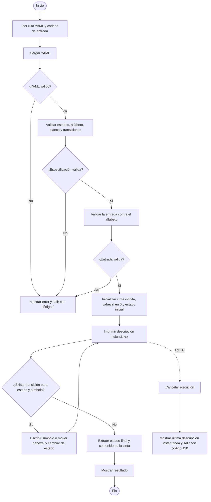

# Simulador de Máquinas de Turing

Simulador de Máquinas de Turing deterministas de una sola cinta, con un único
cabezal y cinta ilimitada en ambas direcciones. Recibe una especificación YAML,
una cadena de entrada y muestra la computación completa como listado de
descripciones instantáneas, además del resultado final.

## Características

- Cinta infinita en ambos sentidos.
- Sin límite de pasos, estados, símbolos ni longitud de entrada.
- Transiciones en formato de cuádruplas de 4 campos.
- Validación defensiva de la especificación y de la entrada.
- Traza completa en streaming, sin almacenar todas las configuraciones.
- Cancelación con `Ctrl+C` para máquinas con computaciones infinitas.
- Resultado final: estado final y contenido de la cinta.
- Ejemplos y pruebas incluidos.

## Requisitos

- Python 3.10 o superior.
- PyYAML (`pip install -r requirements.txt`).

## Estructura del proyecto

```text
.
├── README.md
├── mt_sim.py
├── requirements.txt
├── examples/
│   ├── multiplo_3.yaml
│   └── invierte_binario.yaml
├── tests/
│   ├── __init__.py
│   └── test_mt_sim.py
├── Dockerfile
├── docker-compose.yml
├── .dockerignore
└── .gitignore
```

## Sintaxis de la especificación

La especificación se escribe en YAML. La raíz debe ser un mapa con la clave
`mt`:

```yaml
mt:
  estados: [q0, q1, q_si]
  alfabeto: ['0', '1', 'B']
  estado_inicial: q0
  blanco: B
  transiciones:
    - q0 0 R q0
    - q0 1 R q1
    - q0 B S q_si
```

### Campos de `mt`

| Campo | Obligatorio | Descripción |
|---|---|---|
| `estados` | Sí | Lista no vacía de estados, sin duplicados ni espacios. |
| `alfabeto` | Sí | Lista no vacía de símbolos. Cada símbolo debe ser un único carácter. |
| `estado_inicial` | Sí | Estado inicial; debe pertenecer a `estados`. |
| `blanco` | No | Símbolo que representa una celda en blanco. Por defecto es `B`. Debe pertenecer al alfabeto. |
| `transiciones` | Sí | Lista de transiciones. Puede estar vacía. |

El alfabeto de entrada y el de cinta son el mismo, por lo que la entrada solo
puede contener símbolos presentes en `alfabeto`.

Se recomienda escribir entre comillas los símbolos numéricos (`'0'`, `'1'`) y
los que YAML pueda interpretar como booleanos (`yes`, `no`, `on`, `off`),
aunque el simulador también normaliza valores numéricos YAML a texto. Si un
símbolo es un carácter especial de YAML, como `#`, conviene entrecomillar la
transición completa.

### Formato de las transiciones

Cada transición tiene exactamente **4 campos separados por espacios**:

```text
estado_actual  simbolo_leido  accion  estado_siguiente
```

También se admite la forma de lista YAML de 4 elementos, por ejemplo
`[q0, a, R, q1]`.

La acción determina el tipo de transición:

| Acción | Tipo | Efecto |
|---|---|---|
| `R` | Movimiento | Mueve el cabezal una celda a la derecha. No escribe. |
| `L` | Movimiento | Mueve el cabezal una celda a la izquierda. No escribe. |
| `S` | Movimiento | Mantiene el cabezal en su posición. No escribe. |
| Cualquier símbolo del alfabeto | Escritura | Escribe ese símbolo en la celda actual. No mueve el cabezal. |

Por tanto, para escribir y luego moverse se necesitan dos transiciones, tal
como muestra este fragmento:

```yaml
transiciones:
  - q0 a R q1
  - q1 a X q1
```

- `q0 a R q1`: en `q0`, leyendo `a`, mueve a la derecha y pasa a `q1`.
- `q1 a X q1`: en `q1`, leyendo `a`, escribe `X` y permanece en `q1`.

Las direcciones `R`, `L` y `S` son palabras reservadas y **no pueden formar
parte del alfabeto**.

### Determinismo

Para cada par `(estado_actual, simbolo_leido)` puede existir como máximo una
transición. Si se declaran dos, aunque sean una de escritura y otra de
movimiento, la especificación se rechaza.

### Condición de parada

La máquina se detiene cuando no existe ninguna transición para el estado
actual y el símbolo bajo el cabezal. Esa configuración es la descripción
instantánea final.

### Resultado

El simulador no impone estados de aceptación. El resultado se extrae de la
descripción instantánea final:

- Estado final.
- Contenido de la cinta desde la celda no blanca más a la izquierda hasta la
  celda no blanca más a la derecha.

En las máquinas de decisión de los ejemplos se usan estados como `q_si` y
`q_no`; el usuario interpreta el estado final. En las máquinas que transforman
la entrada, el resultado es el contenido final de la cinta.

### Validaciones defensivas

El simulador rechaza, entre otras, las siguientes situaciones:

- YAML inválido o falta de la clave `mt`.
- Falta de campos obligatorios.
- Estados o símbolos duplicados.
- Estados vacíos o con espacios.
- Símbolos que no son de un único carácter.
- Uso de `R`, `L` o `S` como símbolos del alfabeto.
- Estado inicial inexistente.
- Blanco fuera del alfabeto.
- Transiciones con menos o más de 4 campos.
- Estados o símbolos no declarados en las transiciones.
- Acciones que no son dirección ni símbolo del alfabeto.
- Más de una transición para el mismo `(estado, símbolo leído)`.
- Entrada con símbolos fuera del alfabeto.

Los errores se muestran por `stderr` y el programa termina con código `2`.

## Símbolo de espacio en blanco

El símbolo de blanco es `B` por defecto. Se puede cambiar con el campo
`blanco`, por ejemplo:

```yaml
mt:
  estados: [q0]
  alfabeto: ['a', '_']
  estado_inicial: q0
  blanco: _
  transiciones:
    - q0 a R q0
```

El símbolo elegido debe pertenecer al alfabeto y no puede ser `R`, `L` ni `S`.

## Manual de uso

### Instalación local

```bash
python3 -m venv .venv
source .venv/bin/activate
pip install -r requirements.txt
```

Si el sistema no tiene `python3-venv`, se puede instalar PyYAML con el gestor
de paquetes de la distribución o usar la opción con Docker.

### Ejecución

```bash
python3 mt_sim.py <maquina.yaml> <entrada>
```

Ejemplos:

```bash
python3 mt_sim.py examples/multiplo_3.yaml 1001
python3 mt_sim.py examples/invierte_binario.yaml 1011
python3 mt_sim.py examples/multiplo_3.yaml ""
```

Para la cadena vacía se pasa `""` como segundo argumento.

La ejecución imprime:

1. Datos de la máquina y de la entrada.
2. La descripción instantánea inicial (`Paso 0`).
3. Todas las descripciones instantáneas siguientes.
4. El resultado final.

Ejemplo de salida abreviada:

```text
Máquina: examples/multiplo_3.yaml
Entrada: 1001
Blanco: B
Estado inicial: q0

Paso 0: estado=q0, cinta=... [1] 0 0 1 ...
Paso 1: estado=q1, cinta=... 1 [0] 0 1 ...
...
Paso 5: estado=q_si, cinta=... 1 0 0 1 [B] ...

Resultado final
  Pasos ejecutados: 5
  Estado final: q_si
  Cinta final: 1001
  Descripción final: Paso 5: estado=q_si, cinta=... 1 0 0 1 [B] ...
```

En la cinta mostrada, el símbolo entre corchetes es el que está bajo el
cabezal. Los `...` indican que la cinta continúa con blancos en ambos sentidos.

### Cancelación

Durante una computación infinita se puede pulsar `Ctrl+C`. El simulador
muestra la última descripción instantánea ejecutada y termina con código
`130`. No existe un límite interno de pasos.

### Códigos de salida

| Código | Significado |
|---|---|
| `0` | La máquina se detuvo normalmente. |
| `2` | Especificación o entrada inválida. |
| `130` | Ejecución cancelada por el usuario. |

### Docker

Construir la imagen:

```bash
docker compose build
```

Ejecutar los ejemplos:

```bash
docker compose run --rm mt examples/multiplo_3.yaml 1001
docker compose run --rm mt examples/invierte_binario.yaml 1011
```

El compose monta el repositorio en `/datos` en modo lectura, por lo que también
se pueden usar especificaciones propias:

```bash
docker compose run --rm mt /datos/mi_maquina.yaml "1010"
```

## Ejemplos

### 1. Divisibilidad por 3

La máquina recorre la cadena binaria de izquierda a derecha y actualiza el
resto módulo 3 en el estado:

- `q0`: resto 0.
- `q1`: resto 1.
- `q2`: resto 2.
- `q_si`: el número es divisible por 3.
- `q_no`: el número no es divisible por 3.

Definición completa (`examples/multiplo_3.yaml`):

```yaml
mt:
  estados: [q0, q1, q2, q_si, q_no]
  alfabeto: ['0', '1', 'B']
  estado_inicial: q0
  blanco: B
  transiciones:
    - q0 0 R q0
    - q0 1 R q1
    - q0 B S q_si
    - q1 0 R q2
    - q1 1 R q0
    - q1 B S q_no
    - q2 0 R q1
    - q2 1 R q2
    - q2 B S q_no
```

Entradas de prueba:

| Entrada | Valor decimal | Resultado | Cinta final |
|---|---:|---|---|
| `1001` | 9 | `q_si` | `1001` |
| `101` | 5 | `q_no` | `101` |
| `11` | 3 | `q_si` | `11` |
| `""` | 0 | `q_si` | vacía |

La máquina no modifica la cinta; el resultado se identifica por el estado
final.

### 2. Invertir una cadena binaria

La máquina invierte la cadena en la misma cinta. Usa símbolos auxiliares:

- `X`: celda original con un `0` ya procesado.
- `Y`: celda original con un `1` ya procesado.
- `Z`: separador entre la zona original y la copia invertida.

El algoritmo copia los bits originales de derecha a izquierda al final de la
cinta. Después borra la zona original, las marcas y el separador, dejando
únicamente la cadena invertida.

Definición completa (`examples/invierte_binario.yaml`):

```yaml
mt:
  estados:
    [q0, q_sep, q_find, q_c0, q_c1, q_back, q_cleanup, q_erase_r, q_halt]
  alfabeto: ['0', '1', 'B', 'X', 'Y', 'Z']
  estado_inicial: q0
  blanco: B
  transiciones:
    - q0 0 R q0
    - q0 1 R q0
    - q0 B Z q_sep
    - q_sep Z L q_find
    - q_find X L q_find
    - q_find Y L q_find
    - q_find 0 X q_c0
    - q_find 1 Y q_c1
    - q_find B R q_cleanup
    - q_c0 X R q_c0
    - q_c0 Y R q_c0
    - q_c0 0 R q_c0
    - q_c0 1 R q_c0
    - q_c0 Z R q_c0
    - q_c0 B 0 q_back
    - q_c1 X R q_c1
    - q_c1 Y R q_c1
    - q_c1 0 R q_c1
    - q_c1 1 R q_c1
    - q_c1 Z R q_c1
    - q_c1 B 1 q_back
    - q_back 0 L q_back
    - q_back 1 L q_back
    - q_back Z L q_find
    - q_cleanup X B q_erase_r
    - q_cleanup Y B q_erase_r
    - q_cleanup Z B q_erase_r
    - q_cleanup 0 S q_halt
    - q_cleanup 1 S q_halt
    - q_cleanup B S q_halt
    - q_erase_r B R q_cleanup
```

Entradas de prueba:

| Entrada | Cinta final (resultado) |
|---|---|
| `1011` | `1101` |
| `100` | `001` |
| `1001` | `1001` |
| `""` | vacía |

Los símbolos `X`, `Y` y `Z` son auxiliares de la máquina. Para este ejemplo la
entrada debe ser una cadena binaria (`0` y `1`), aunque el alfabeto declarado
contenga también esos auxiliares.

## Diagrama de flujo



## Complejidad

Sea `n` la longitud de la entrada, `p` el número de pasos ejecutados y `w` el
ancho de cinta mostrado en una descripción instantánea.

- Cada paso de la máquina actualiza `O(1)` celdas.
- El simulador genera una instantánea de la cinta y la formatea para cada
  descripción instantánea. Copiar y formatear cuesta `O(w)` por paso.
- Al emitir la traza completa, el tiempo total del simulador es
  `O(sum(w_i))` para `i = 0..p`. La memoria se mantiene en `O(w)` porque la
  traza se emite en streaming y no se almacenan todas las configuraciones.

| Máquina de ejemplo | Pasos de la máquina | Espacio de cinta | Tiempo total con traza |
|---|---|---|---|
| Divisibilidad por 3 | `O(n)` | `O(n)` | `O(n²)` |
| Invertir cadena binaria | `O(n²)` | `O(n)` | `O(n³)` |

En la máquina de divisibilidad, cada bit se procesa una vez y luego se hace un
único movimiento final para fijar el estado de respuesta. En la máquina de
inversión, cada uno de los `n` bits originales obliga a recorrer la cinta para
localizar el siguiente bit, copiarlo al final y volver, lo que produce
`O(n²)` pasos. La cinta crece hasta almacenar la entrada, el separador y la
copia invertida, es decir, `O(n)` celdas.

## Pruebas

```bash
python3 -m unittest discover -v
```

Las pruebas cubren validación de especificaciones, conflictos de transiciones,
símbolos reservados, normalización de símbolos numéricos, simulación de las
dos máquinas, cinta infinita y cancelación con `Ctrl+C`.
